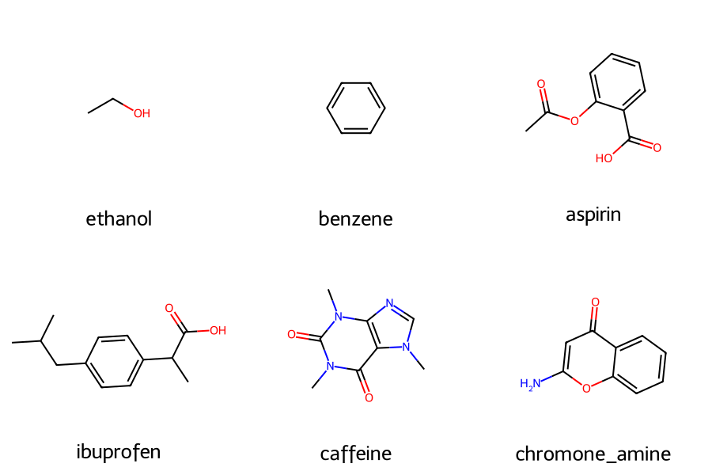
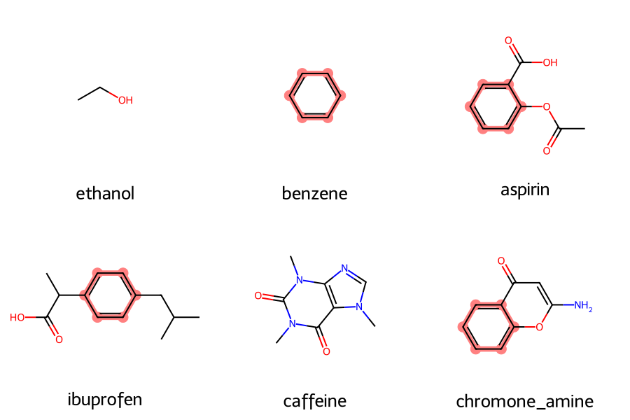

# Day 9: Molecule grid image generator

**What:** Draws a list of SMILES as a labelled grid image (PNG or SVG) with RDKit. It can highlight and align a common substructure, show atom numbers, use black-and-white atoms, split long lists into pages, and size the image for a given figure width and DPI.
**Why:** Every paper, thesis chapter and slide deck needs a "scope" or "compounds studied" figure. Drawing structures one by one in ChemDraw is slow and hard to keep consistent. This makes the whole figure from the same SMILES file you already use for the other tools.

## Install
```bash
pip install rdkit
```

## Usage
```bash
python tool.py example/input.smi -o grid.png
```


Highlight a substructure and orient every molecule by it, which is useful for a series that shares a scaffold:
```bash
python tool.py example/input.smi -o grid_highlight.png --highlight "c1ccccc1" --align
```
```
highlight: pattern found in 4 of 6 molecules
align: oriented 4 molecules
```


Size the figure for a journal. For a 6.5 inch wide figure at 300 dpi with 3 columns:
```bash
python tool.py example/input.smi -o fig1.png --cols 3 --width-in 6.5 --dpi 300
```
Vector output for editing in Inkscape or Illustrator:
```bash
python tool.py example/input.smi -o grid.svg --legend formula
```

| Option | Meaning |
|---|---|
| `-o` | output file, `.png` or `.svg` (default `grid.png`) |
| `--cols` | molecules per row (default 3) |
| `--size` | pixels per molecule (default 300) |
| `--width-in`, `--dpi` | total figure width in inches and resolution. This sets the pixel size and the PNG's DPI metadata |
| `--legend` | label under each molecule: `name`, `smiles`, `formula`, `mw` or `none` |
| `--per-page` | molecules per image. Extra pages are written as `grid_1.png`, `grid_2.png`, ... |
| `--highlight SMARTS` | highlight the first match of this substructure in every molecule |
| `--align` | orient molecules by the highlighted substructure (needs `--highlight`) |
| `--atom-indices` | show atom numbers (handy when discussing NMR or DFT atom labels) |
| `--bw` | black-and-white atoms for journals that print in grayscale |

Input is a `.smi` file (one SMILES per line, optional name after a space, `#` for comments) or a single SMILES string. Invalid SMILES are skipped with a message and the exit code is 1, the rest are still drawn.

## Method
1. Parse each SMILES with RDKit and build the legend text (name, SMILES, formula or molecular weight).
2. With `--highlight`, find the first substructure match in each molecule and highlight its atoms and the bonds between them. With `--align`, redraw the molecules so that substructure has the same orientation (RDKit's matching-depiction routine).
3. Draw with RDKit's `MolsToGridImage` and save. A figure width in inches times DPI, divided by the number of columns, gives the pixels per molecule.

## Test
```bash
pytest days/day09-molecule-grid
```
The tests check image dimensions, the PNG signature and DPI metadata, SVG output, pagination, the highlight and alignment counts, and the error messages.

## Limitations
- Uses RDKit's automatic 2D layout. Complicated polycycles and cages may need manual cleanup in a drawing program, and `--align` skips molecules without the pattern.
- Only the first match of the highlight pattern is shown in each molecule.
- Legends are not wrapped, so very long names or SMILES can run past the edge of a cell. Use a larger `--size` or fewer columns.
- No reaction schemes. Reaction drawing is planned for Day 48.
- The DPI value is written into the PNG and used to compute the pixel size. It does not make the drawing itself sharper than the pixels allow, so for large print figures prefer SVG.

## Next
Day 10: index page with day links and a GitHub Actions lint check.
