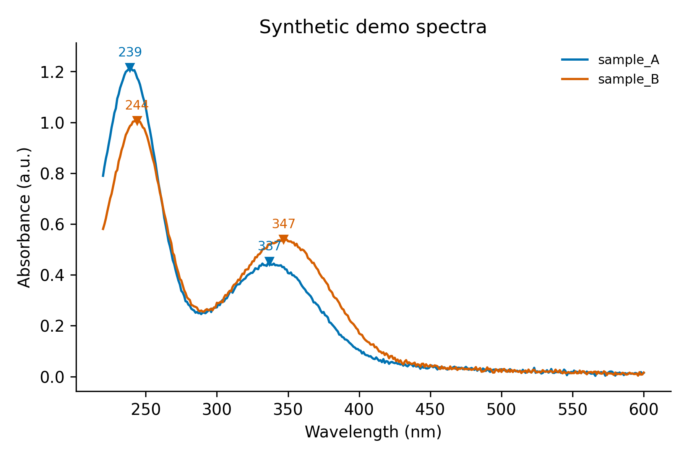

# Day 11: UV-vis plotter with peak detection

**What:** Plots one or more UV-vis spectra from CSV, TSV or TXT files and finds the absorption peaks: position, height, width and prominence. It reads instrument exports with header lines and writes a clean figure plus a peak table.
**Why:** The first thing you do with a new carbon dot or dye sample is plot its spectrum and note where the bands are (for example the pi-pi* band near 240 nm and the n-pi* band near 340 nm). Doing it in a spreadsheet and reading the maxima by eye is slow and not reproducible.

## Install
```bash
pip install numpy scipy matplotlib
```

## Usage
```bash
python tool.py example/synthetic_cqd.csv -o uvvis.png --title "Synthetic demo spectra"
```
```
[ok] 2 spectra -> uvvis.png
sample    peak (nm)      abs  FWHM (nm)  prominence
sample_A      239.0    1.216       24.9       0.426
sample_A      337.0    0.453       48.1       0.207
sample_B      244.0    1.007       28.8       0.426
sample_B      347.0    0.540       55.7       0.284
```


**The example data are synthetic.** `example/synthetic_cqd.csv` was generated by `make_example.py` (fixed random seed) from two Gaussian bands on a decaying baseline plus noise. It only imitates the general shape often reported for carbon dots and is not measured data. Use your own spectra for real work.

More examples:
```bash
python tool.py a.csv b.csv --normalize --stack 0.3 -o compare.png      # overlay, scaled to 1, offset
python tool.py sample.csv --smooth 11 --prominence 0.02 --peaks-csv peaks.csv
python tool.py sample.csv --zero-at 800 --xmin 250 --xmax 600 -o plot.svg
python tool.py transmittance.csv --percent-t -o abs.png                  # %T to absorbance
```

| Option | Meaning |
|---|---|
| `-o` | plot file: `.png`, `.svg` or `.pdf` (default `uvvis.png`) |
| `--peaks-csv` | also write the peak table to a CSV |
| `--prominence` | minimum peak prominence in plotted units (default: 5% of the data range) |
| `--min-separation` | minimum distance between two peaks in nm (default 10). The stronger one is kept |
| `--smooth N` | Savitzky-Golay smoothing, window of N points (odd, at least 5) |
| `--zero-at NM` | subtract the absorbance at this wavelength, a quick scattering baseline (for example 800) |
| `--normalize` | scale each spectrum to a maximum of 1 |
| `--percent-t` | the input is percent transmittance, convert to absorbance |
| `--xmin`, `--xmax` | wavelength range to use (nm) |
| `--stack` | vertical offset between spectra |
| `--no-labels`, `--title`, `--figsize W H`, `--dpi` | plot appearance |

## Input files
Wavelength in nm in column 1 and absorbance in the other columns. The reader skips instrument metadata lines, uses the last text line before the data as the column names, accepts commas, tabs, semicolons or spaces (with decimal commas when the separator is a semicolon), sorts descending scans, drops duplicate wavelengths and ignores footer lines. With several files, columns with the same name get the file name as a prefix.

## Method
The processing order is: percent T to absorbance, crop to the range, subtract the baseline point, smooth, normalize. Peaks are then found with `scipy.signal.find_peaks` using the prominence and minimum separation. The width is `scipy.signal.peak_widths` at half of each peak's prominence, converted from points to nm by interpolation. Colors come from the Okabe-Ito palette, which stays distinguishable for common types of color blindness.

## Test
```bash
pytest days/day11-uv-vis-plotter
```
The tests recover known Gaussian peak positions, heights and widths, and cover the prominence and separation limits, smoothing, each input format and every error message.

## Limitations
- The width is measured at half of the prominence, so it equals a true FWHM only for an isolated peak on a flat baseline. For a peak on a sloping baseline or at the edge of the data it is smaller. In the example, the first band is cut at 220 nm, which is why its width is only 25 nm.
- Shoulders without a local maximum are not detected.
- Peak positions are read off the data grid, so the precision is the step size of the scan (1 nm in the example). Overlapping bands also shift each other's apparent maxima.
- Smoothing changes the peak heights and widths a little. Report which settings you used.
- Wavelength is assumed to be in nm. Use Day 7 to convert from other units.
- Band gap analysis (Tauc plots) comes in Day 12.

## Next
Day 12: Tauc plot and optical band gap calculator.
