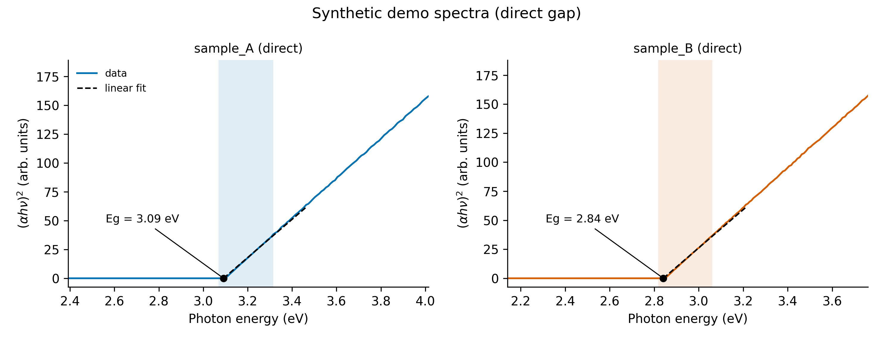

# Day 12: Tauc plot and optical band gap

**What:** Turns a UV-vis absorbance spectrum (or a diffuse-reflectance spectrum) into a Tauc plot, finds the linear region, and extrapolates it to the energy axis to give the optical band gap Eg with a fit uncertainty.
**Why:** The optical band gap is one of the first numbers reported for carbon dots, quantum dots and semiconductor powders, and it is usually read off a hand-drawn tangent in a spreadsheet. This makes the choice of fit region explicit and repeatable, and gives the plot and the numbers together.

## Install
```bash
pip install numpy matplotlib
```

## Usage
```bash
python tool.py example/synthetic_tauc.csv -o tauc.png --title "Synthetic demo spectra (direct gap)"
```
```
[ok] 2 spectra -> tauc.png
sample    transition   Eg (eV)  +/- (eV)   fit range (eV)       R2     n
sample_A  direct         3.091    0.0019        3.07-3.32   0.9930    31
sample_B  direct         2.841    0.0018        2.82-3.06   0.9923    36
```


**The example data are synthetic.** `example/synthetic_tauc.csv` is generated by `make_example.py` (fixed random seed) from the direct-gap Tauc law with true gaps of 3.10 and 2.85 eV, a small tail below the gap, a baseline offset and noise. The tool recovers them to within 0.01 eV. Real spectra are messier, so expect more sensitivity to the fit region than this example shows.

More examples:
```bash
python tool.py spectrum.csv --transition indirect --zero-at 700 --csv gaps.csv
python tool.py spectrum.csv --fit-range 3.3 3.7          # choose the linear region yourself
python tool.py drs.csv --signal reflectance-percent       # powders: Kubelka-Munk
python tool.py spectrum.csv --columns sample_A sample_C   # only some columns
```

| Option | Meaning |
|---|---|
| `--transition` | `direct` (default), `indirect`, `direct-forbidden` or `indirect-forbidden` |
| `--signal` | `absorbance` (default), `reflectance` (fraction) or `reflectance-percent` |
| `--path-length-cm` | cuvette path length for absorbance (default 1) |
| `--x-unit` | `nm` (default) or `ev` for column 1 |
| `--zero-at NM` | subtract the absorbance at this wavelength first, a baseline correction (e.g. 700) |
| `--fit-range EMIN EMAX` | fit exactly this energy range (eV) instead of searching |
| `--emin`, `--emax` | limit where the automatic search may look |
| `--window`, `--r2-min` | automatic search: window width in eV (default 0.25) and minimum R2 (default 0.99) |
| `--columns` | which signal columns to analyze (default all) |
| `-o`, `--csv`, `--title`, `--figsize`, `--dpi` | output |

Input files are read like Day 11: wavelength in column 1, signal in the others, header and metadata lines are skipped.

## Method
1. Convert wavelength to photon energy: hv (eV) = 1239.842 / wavelength (nm).
2. Absorption coefficient: alpha = 2.303 A / l from absorbance A and path length l (cm). For reflectance R, the Kubelka-Munk function F(R) = (1 - R)^2 / (2R) takes the place of alpha.
3. Tauc plot: y = (alpha hv)^r against hv, with r depending on the transition.

| Transition | r |
|---|---|
| direct allowed | 2 |
| indirect allowed | 1/2 |
| direct forbidden | 2/3 |
| indirect forbidden | 1/3 |

4. Find the linear region. A window of fixed width slides along the curve. Among windows with R2 at least `--r2-min`, those with a slope within 80% of the steepest are kept, and the one at the lowest energy (closest to the absorption edge) is used. If no window reaches the R2 threshold, the best-R2 window is used and a warning is printed. With `--fit-range` this step is skipped.
5. Fit a line y = m hv + b. The band gap is the intercept with the energy axis, Eg = -b / m. Its uncertainty is propagated from the covariance of the fit (a test checks it against the scatter of repeated noisy fits).

## Test
```bash
pytest days/day12-tauc-band-gap
```
The tests recover known gaps for all four transition types over many noise levels, check the conversions, Kubelka-Munk, baseline correction, the uncertainty formula, the warnings and the error messages.

## Limitations
- **The transition type is a choice, not a result.** The same spectrum gives different gaps for direct and indirect, and the data alone often cannot decide. State the transition you assumed.
- **The uncertainty is only the statistical error of the line fit.** It does not include the effect of the fit window, the baseline, scattering or the instrument, which are usually larger. Report the fit range, and check how Eg moves when you change `--window` or `--fit-range`.
- Tauc analysis assumes a semiconductor-like absorption edge. Carbon dots and molecular-like nanoparticles often have broad bands and no clean linear region, so inspect the plot before trusting any number.
- The alpha from a solution absorbance spectrum is a proxy. Scattering adds to the absorbance, and without a concentration the absolute scale is not meaningful (only the intercept matters, not the slope).
- A baseline offset shifts the result. Use `--zero-at` with a wavelength where the sample does not absorb.
- A very steep or very noisy edge can leave no window above the R2 threshold. Lower `--r2-min`, change `--window`, or pick the region with `--fit-range`.

## Next
Day 13: fluorescence quantum yield (relative method) calculator.
