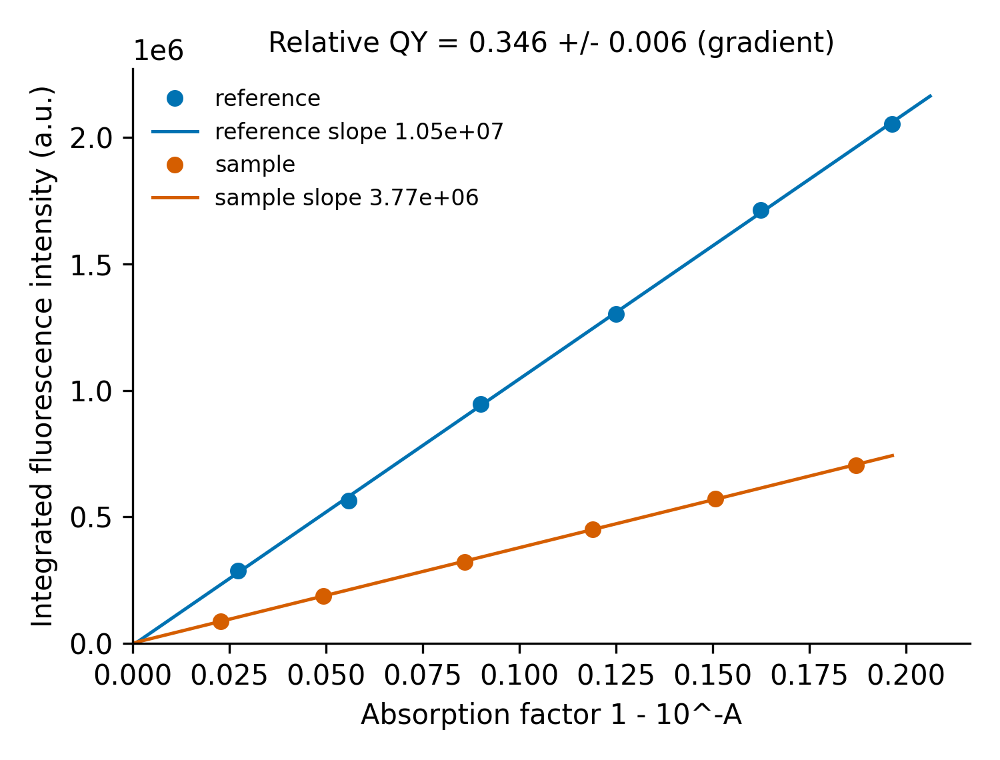

# Day 13: Fluorescence quantum yield (relative method)

**What:** Calculates the fluorescence quantum yield of a sample by comparison with a reference standard of known quantum yield, using the IUPAC relative method. It supports the gradient method (several concentrations) and the single-point method, with the refractive-index correction, an uncertainty from the fit, and checks for the usual measurement pitfalls.
**Why:** The quantum yield is a headline number for carbon dots and other emitters, and it is easy to get wrong: mixing up absorbance and absorption factor, forgetting the solvent refractive index, or measuring above the linear range. This follows the published equation and tells you when the data break its assumptions.

## Install
```bash
pip install numpy matplotlib
```

## Usage
You need, for the reference and the sample, the **absorbance at the excitation wavelength** and the **integrated emission intensity** (area under the corrected emission spectrum) for several dilutions. Put them in two CSV files with an absorbance column and an intensity column.
```bash
python tool.py --ref example/synthetic_reference.csv --sample example/synthetic_sample.csv \
    --standard fluorescein --sample-solvent ethanol --plot qy_fit.png
```
```
Relative quantum yield (gradient method)
  reference:        fluorescein in 0.1 M NaOH, QY 0.925
  refractive index: reference 1.333, sample 1.361, (n_s/n_ref)^2 = 1.0425
  gradient reference: 1.052e+07 +/- 8.7e+04 (R2 0.9997, 6 points)
  gradient sample:    3.771e+06 +/- 1.7e+04 (R2 0.9999, 6 points)
  QY sample = 0.346 +/- 0.006
```


**The example data are synthetic.** `make_example.py` generates them (fixed random seed) from the IUPAC equation with a true sample yield of 0.35, 1% noise and invented instrument constants. The tool recovers 0.346 +/- 0.006. They are not measured data.

One measurement each (single-point method):
```bash
python tool.py --ref-point 0.05 1.2e6 --sample-point 0.05 4.0e5 --standard quinine-hclo4 --sample-solvent water
```
```
Relative quantum yield (single-point method)
  reference:        quinine in 0.1 M HClO4, QY 0.6
  refractive index: reference 1.333, sample 1.333, (n_s/n_ref)^2 = 1.0000
  QY sample = 0.200 +/- 0.007
```
Here the +/- comes only from the reference's own uncertainty, since one point has no scatter to estimate.

Your own reference value and solvents (use this when a paper gives a different value than the built-in one):
```bash
python tool.py --ref ref.csv --sample s.csv --ref-qy 0.54 --ref-qy-unc 0.02 --ref-solvent water --sample-n 1.361
```

| Option | Meaning |
|---|---|
| `--ref`, `--sample` | CSV files (absorbance and integrated intensity columns, found by header name or by position) |
| `--ref-point A I`, `--sample-point A I` | a single measurement instead of a file |
| `--standard NAME` | built-in standard, see `--list-standards` |
| `--ref-qy`, `--ref-qy-unc` | your own reference value and its uncertainty (override `--standard`) |
| `--ref-solvent`, `--sample-solvent` | looked up in the refractive-index table (`--list-solvents`) |
| `--ref-n`, `--sample-n` | refractive indices directly |
| `--absorbance` | use absorbance A instead of the absorption factor 1 - 10^-A |
| `--through-origin` | force the gradient fits through zero |
| `--plot`, `--csv` | save the fit plot and a one-row result CSV |

## Built-in standards
Values and conditions are from Table 1 of the IUPAC Technical Report on standards (Brouwer, *Pure Appl. Chem.* 2011, 83, 2213), which reviews the three best-established standards. Check `--list-standards` for the excitation and emission ranges.

| Key | Standard | QY | Original source |
|---|---|---|---|
| `quinine-sulfate` | quinine sulfate in 0.5 M H2SO4 | 0.546 | Melhuish 1961 (25 C) |
| `quinine-hclo4` | quinine in 0.1 M HClO4 | 0.60 +/- 0.02 | NIST SRM 936 (1980) |
| `fluorescein` | fluorescein in 0.1 M NaOH | 0.925 +/- 0.015 | Magde et al. 2002 |
| `rhodamine-6g` | rhodamine 6G in ethanol | 0.95 +/- 0.015 | Magde et al. 2002 |
| `rhodamine-6g-water` | rhodamine 6G in water | 0.92 +/- 0.02 | Magde et al. 2002 |

**Quoted values differ between papers.** The same report lists, for example, 0.95 for fluorescein (1978) and 0.925 (2002), several different values for quinine sulfate in 0.05 M H2SO4 (0.51 to 0.60 depending on the study), and notes that papers use 0.52 to 0.57 for quinine sulfate and 0.94 to 1.0 for rhodamine 6G. Use the value that matches the reference and conditions you cite, enter it with `--ref-qy` if it differs, and state it in your methods. I could only check the built-in values against that report, not against the original papers.

## Method
The IUPAC equation (eq. 1 of the report) is

QY_x = QY_ref x (F_x / F_ref) x (f_ref / f_x) x (n_x / n_ref)^2

with F the integrated emission, f = 1 - 10^(-A) the absorption factor and n the refractive index of the solvent.
- **Gradient method** (3 or more points each): F is plotted against f for each solution and the slopes m are compared, QY_x = QY_ref (m_x / m_ref)(n_x / n_ref)^2. This averages out the error of single readings and shows non-linearity.
- **Single-point method** (1 point each): the equation is applied directly.
- **Uncertainty (gradient):** the relative uncertainties of the two slopes (standard errors of the fits) and of the reference QY, when given, are added in quadrature. A test checks this against the scatter of 300 simulated noisy experiments.
- By default the fits are free lines. A large intercept points to a background problem and triggers a warning.

## Warnings it gives
- absorbance above 0.1 at the excitation wavelength (inner-filter effects, IUPAC recommends A < 0.1)
- a fit with R2 below 0.99, a large intercept, or a narrow absorbance range
- a quantum yield above 1

## Test
```bash
pytest days/day13-quantum-yield
```
The tests check the equation in each branch (refractive index, absorption factor versus absorbance, single point versus gradient), exact recovery of a known yield, the uncertainty against simulations, the standards table against the report, each warning, the file reader and every error message.

## Limitations
- You supply the integrated intensities. The tool does not integrate spectra or correct them for the instrument response, and it cannot check that the sample and reference use the same excitation wavelength, cuvette and slit settings, which is what the method needs.
- The refractive-index table gives values near 20 C for pure solvents. Dilute aqueous solutions are treated as water, which is a small approximation.
- The uncertainty covers the fit scatter and the reference value only. It does not include errors in the absorbance readings, the spectral correction or the reference's own systematic error.
- Relative measurements assume the sample and reference emit in a similar spectral range. A large mismatch adds error from imperfect instrument correction.
- Scattering particles, such as nanoparticle suspensions with turbidity, inflate the measured absorbance and give a quantum yield that is too low.
- It is for dilute solutions. Solid samples need an integrating sphere and a different method.

## Next
Day 14: PL spectrum plotter with excitation-dependent emission overlay.
