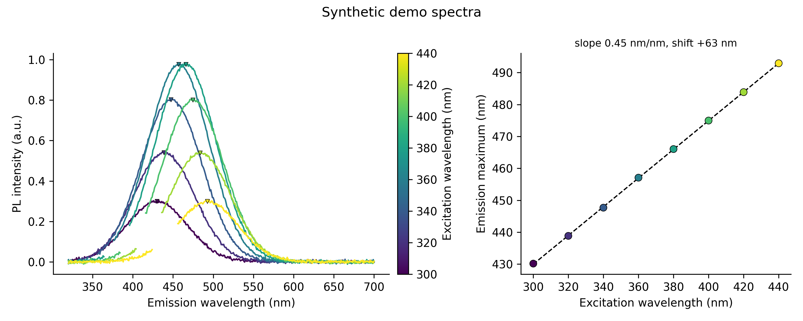

# Day 14: PL spectrum plotter with excitation-dependent emission overlay

**What:** Plots emission spectra recorded at several excitation wavelengths, colored by excitation, finds the emission maximum of each, and shows how the maximum shifts with excitation (slope, total shift). It can blank out the scattered excitation light that otherwise gets mistaken for emission.
**Why:** Excitation-dependent emission is one of the first things reported for carbon dots, and the standard figure is the colored overlay plus a plot of emission maximum against excitation wavelength. Reading the maxima by eye is slow and error-prone, and a scatter peak can quietly produce a wrong maximum.

## Install
```bash
pip install numpy scipy matplotlib
```

## Usage
One CSV with the emission wavelength in column 1 and one intensity column per excitation wavelength. The excitation wavelength is read from the column header (`340`, `ex340`, `Ex 340 nm`, ...):
```bash
python tool.py example/synthetic_pl.csv -o pl.png --mask-scatter 15 --title "Synthetic demo spectra"
```
```
[ok] 8 spectra -> pl.png
 ex (nm)  em max (nm)  intensity  FWHM (nm)
     300        430.2      0.298       89.5
     320        438.8      0.539       89.4
     340        447.7      0.802       89.8
     360        457.1      0.976       89.7
     380        466.0      0.977       89.5
     400        475.0      0.801       89.0
     420        483.9      0.538       90.3
     440        492.9      0.298        n/a
emission maximum vs excitation: slope 0.449, R2 1.000; +62.7 nm over 140 nm of excitation
```


**The example data are synthetic.** `make_example.py` generates them (fixed random seed): Gaussian bands whose maximum moves as 430 nm + 0.45 x (excitation - 300 nm), plus Rayleigh and second-order scatter, and noise. The tool recovers the slope 0.449 (true 0.45) and every maximum to within 0.3 nm. They are not measured data. FWHM is `n/a` for the 440 nm spectrum because its short-wavelength half-height point (about 448 nm) lies inside the masked Rayleigh region (425 to 455 nm), so it cannot be measured.

### Why `--mask-scatter` matters
Real fluorimeter scans contain a Rayleigh peak at the excitation wavelength and a second-order peak at twice that wavelength. In the example the second-order peak at 600 nm is stronger than the 300 nm-excited emission. Without masking:
```
     300        599.8      0.353       14.1
     ...
emission maximum vs excitation: slope -0.257, R2 0.062; -106.9 nm over 140 nm of excitation
[warn] ex 300 nm: the maximum (599.8 nm) is within 15 nm of second-order scatter; use --mask-scatter
```
The tool always searches only above the excitation wavelength plus 10 nm (`--search-offset`), which removes the Rayleigh peak, and it warns when a maximum lands close to either scatter order. `--mask-scatter 15` blanks both regions in the plot and in the search.

More examples:
```bash
python tool.py ex340.csv ex360.csv ex380.csv --normalize --csv maxima.csv   # one file per excitation, name gives the wavelength
python tool.py spectra.csv --ex 300 320 340 360 --stack 0.5 --overlay-only  # excitation given by hand, stacked, no shift panel
python tool.py spectra.csv --smooth 11 --xmin 380 --xmax 650 --cmap plasma
```

| Option | Meaning |
|---|---|
| `-o` | plot file: `.png`, `.svg` or `.pdf` (default `pl.png`) |
| `--csv` | write the emission maxima (excitation, emission maximum, intensity, FWHM) |
| `--ex` | excitation wavelengths in nm, in the order of the spectra (otherwise read from the header or file name) |
| `--mask-scatter NM` | blank Rayleigh and second-order scatter within +/- NM of ex and 2 x ex (try 15) |
| `--search-offset` | look for the maximum only above ex + this many nm (default 10) |
| `--normalize` | scale each spectrum to a maximum of 1 |
| `--smooth N` | Savitzky-Golay smoothing, odd window of at least 5 points |
| `--xmin`, `--xmax` | emission range to use |
| `--stack` | vertical offset between spectra |
| `--cmap` | matplotlib colormap (default viridis) |
| `--overlay-only` | skip the emission-vs-excitation panel |
| `--title`, `--figsize`, `--dpi` | appearance |

## Method
1. Read the spectra (same file reader as Days 11 and 12: headers and metadata lines are skipped, separators are detected) and sort them by excitation wavelength.
2. Optionally crop, smooth, blank the scatter regions, and normalize each spectrum to its own maximum.
3. For each spectrum take the highest point above ex + `--search-offset`, then refine the position and height with a parabola fitted to the points above 90% of the maximum. This is much less noisy than a three-point parabola for a broad band.
4. FWHM is the width at half of the maximum height, found by linear interpolation. It is reported as `n/a` if the band does not drop below half height on both sides within the data.
5. With 3 or more spectra, fit a straight line to emission maximum against excitation wavelength and report the slope, R2 and the shift between the first and last spectrum.

## Test
```bash
pytest days/day14-pl-excitation-overlay
```
The tests cover every header and file-name style for the excitation wavelength, the maximum on noisy broad bands, FWHM of known Gaussians, the Rayleigh and second-order cases, the shift fit, the plot formats and every error message.

## Limitations
- The spectra should be corrected for the instrument response and lamp output before you compare intensities and maxima between excitation wavelengths. The tool does not do this.
- The slope is a description of your data. A nonzero slope does not by itself show a particular origin of the emission. Samples with several emitting species also give an apparent shift.
- A band that is cut off by the end of the scan has no reliable FWHM, and its maximum can be wrong. Extend the scan range.
- FWHM is measured from zero intensity. A background offset or overlapping scatter changes it.
- With fewer than 3 spectra there is no slope. Only emission maxima that are above ex + `--search-offset` are found.
- Scatter masking removes real emission that happens to lie in the masked ranges.
- Peak positions depend on whether you plot against wavelength or energy. Day 7 converts between them.

## Next
Day 15: Stokes shift calculator.
