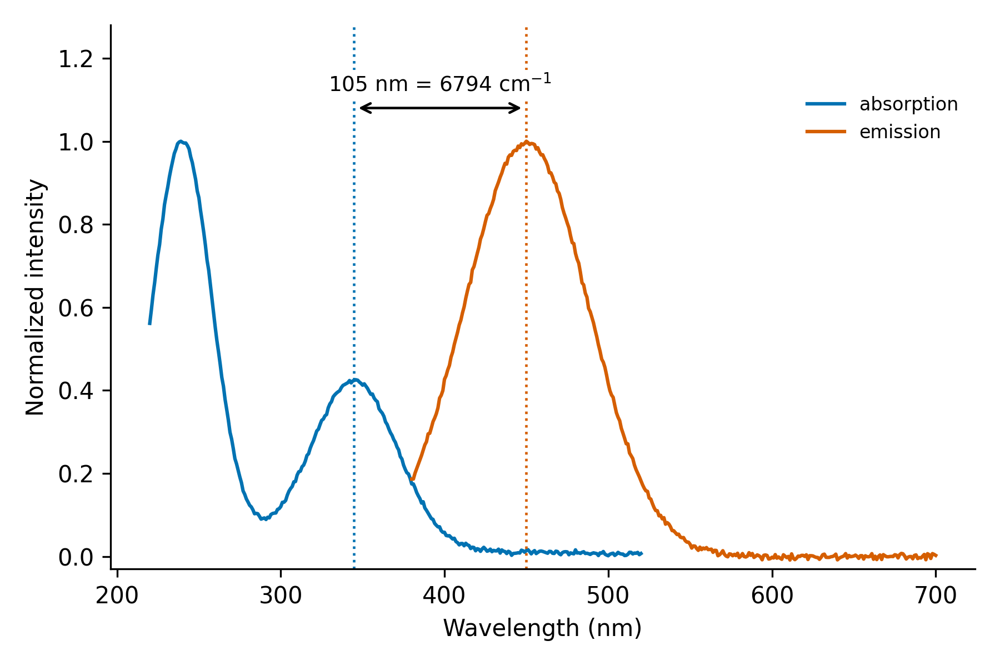

# Day 15: Stokes shift calculator

**What:** Calculates the Stokes shift (the gap between the absorption and emission maxima) in nm, cm-1 and eV, from two numbers, from an absorption and an emission spectrum, or for a whole table of samples, with an optional uncertainty and a figure.
**Why:** The Stokes shift is quoted for every fluorophore, and it is easy to get inconsistent: nm values cannot be compared between spectral regions, the wrong absorption band is often picked, and the cm-1 conversion is done by hand. This does the conversion, picks the bands the way you tell it to, and makes the choice visible.

## Install
```bash
pip install numpy scipy matplotlib
```

## Usage
Two numbers (absorption maximum, emission maximum, in nm):
```bash
python tool.py 345 450
```
```
sample  abs (nm)   em (nm)  shift (nm)  shift (cm-1)  shift (eV)
sample     345.0     450.0       105.0          6763       0.839
```
From spectra. Which absorption band you use matters, so say it with `--abs-peak`:
```bash
python tool.py --abs example/synthetic_absorption.csv --em example/synthetic_emission.csv --abs-peak max
python tool.py --abs example/synthetic_absorption.csv --em example/synthetic_emission.csv --abs-peak longest -o stokes.png
```
```
sample     239.8     450.0       210.1         19470       2.414      <- tallest band (240 nm)
sample     344.6     450.0       105.4          6794       0.842      <- longest-wavelength band
```


**The example data are synthetic.** `make_example.py` generates them (fixed random seed): an absorption spectrum with a strong band at 240 nm and a weaker one at 345 nm, and an emission band at 450 nm. They are invented numbers, not measured data. The two results above differ by a factor of three for the same sample, which is the point of the next section.

A table of samples (columns `name`, `abs_max_nm`, `em_max_nm`; the columns are found by header name), with a bar chart and a CSV:
```bash
python tool.py --table example/samples.csv -o shifts.png --csv shifts.csv
```
```
sample    abs (nm)   em (nm)  shift (nm)  shift (cm-1)  shift (eV)
sample_A     345.0     450.0       105.0          6763       0.839
sample_B     352.0     468.0       116.0          7042       0.873
sample_C     330.0     415.0        85.0          6207       0.770
sample_D     360.0     500.0       140.0          7778       0.964
```
Energies instead of wavelengths, and an uncertainty from the wavelength reading error:
```bash
python tool.py 3.59 2.76 --input-unit ev
python tool.py 400 500 --unc 2        # 5000 cm-1, +/- 148 cm-1 for +/- 2 nm on each maximum
```

| Option | Meaning |
|---|---|
| `ABS EM` | the two maxima, in `--input-unit` (nm, ev or cm-1) |
| `--abs FILE`, `--em FILE` | spectra (wavelength in nm, then intensity). `--abs-column` and `--em-column` pick a column by name or number |
| `--abs-peak` | `max` (tallest band, default) or `longest` (the longest-wavelength band) |
| `--abs-range LOW HIGH`, `--em-range LOW HIGH` | search only this wavelength range |
| `--smooth N`, `--prominence` | smoothing window, and the minimum band prominence for `longest` |
| `--table FILE` | a CSV of samples |
| `--unc NM` | uncertainty of each wavelength, for the error on the shift |
| `-o`, `--csv`, `--dpi` | figure (spectra or table mode) and results CSV |

## Which absorption band?
The Stokes shift is normally measured from the maximum of the **lowest-energy (longest-wavelength) absorption band** to the emission maximum, because emission usually starts from the lowest excited state. The tallest absorption band is often a higher transition, so using it inflates the shift, as in the example (210 nm against 105 nm). For samples with one broad, unresolved absorption, such as many carbon dots, there may be no clean lowest band. Use `--abs-range`, say which band you used, and be careful when comparing with other papers.

## Method
- Shift in nm is `em - abs`. In wavenumbers it is `1e7/abs - 1e7/em` (cm-1), and in eV it is `1239.842 x (1/abs - 1/em)`. The energy units are the ones to compare between samples, since the same shift in nm means different energies at different wavelengths.
- Band positions in a spectrum are refined with a parabola fitted to the top of the peak (the points above 90% of the maximum, at least 5 points), so they are not limited to the scan step.
- `longest` finds all bands with a prominence of at least 5% of the data range (change it with `--prominence`) and takes the one at the longest wavelength.
- The uncertainty is propagated from the wavelength uncertainties you give: sigma(cm-1) = 1e7 x sqrt((s/abs^2)^2 + (s/em^2)^2). A test checks it against a simulation.

## Test
```bash
pytest days/day15-stokes-shift
```
The tests check the numbers in all three units, the uncertainty against a simulation, the choice of band, coarse-scan peak positions, the file and table readers, the plots and every error message.

## Limitations
- The result depends on the bands you pick. It does not decide for you which transition is the lowest-energy one.
- Maxima of broad bands depend on whether the spectrum is plotted against wavelength or energy, and the maximum shifts slightly between the two. Quote the convention you used.
- The uncertainty only reflects the wavelength error you supply. It does not include the choice of band, solvent effects or instrument calibration.
- Emission spectra should be corrected for the instrument response, which can move the maximum. The tool does not correct them.
- Emission is taken as the highest point, which suits a single band. For several emission bands use `--em-range`.
- A shift under 5 nm, or an emission maximum below the absorption maximum, is flagged because it often means a scatter peak or the wrong band.

## Next
Day 16: FTIR peak picker with functional-group suggestions.
