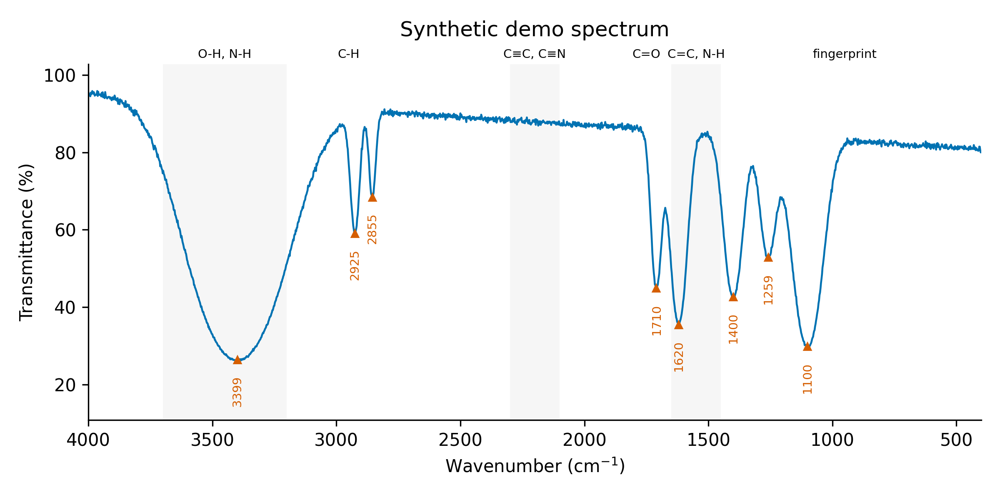

# Day 16: FTIR peak picker with functional-group suggestions

**What:** Finds the peaks in an FTIR spectrum (transmittance or absorbance), measures their position, relative intensity and width, and lists the functional groups whose characteristic band ranges they fall in, with an annotated plot and a peak table.
**Why:** Assigning an FTIR spectrum means reading peak positions off the plot and looking each one up in a correlation table. This does the peak picking reproducibly and puts the candidate groups next to each peak, which is the first pass for any new carbon dot, polymer or catalyst.

**Suggestions are not assignments.** Many groups overlap, positions shift with hydrogen bonding, conjugation and sample preparation, and a band's absence is often more informative than its presence. Use the list as a starting point and confirm with other evidence (XPS, NMR, elemental analysis).

## Install
```bash
pip install numpy scipy matplotlib
```

## Usage
```bash
python tool.py example/synthetic_ftir.csv -o ftir.png --title "Synthetic demo spectrum" --csv peaks.csv --top 2
```
```
8 peaks in 400-4000 cm-1 (signal read as percent transmittance)
   3399 cm-1  strong, broad (FWHM 376), A = 0.583
            1. Alcohol/phenol O-H stretch (hydrogen-bonded) (3200-3550, s, broad)
            2. Amine N-H stretch (3300-3500, m)
   2925 cm-1  medium, sharp (FWHM 38), A = 0.230
            1. Alkyl C-H stretch (2850-2950, m-s)
            2. Carboxylic acid O-H stretch (2500-3000, v, broad)
   ...
   1710 cm-1  medium, sharp (FWHM 34), A = 0.349
            1. Aldehyde C=O stretch (1690-1740, s)
            2. Ketone C=O stretch (1680-1750, s)
   1620 cm-1  strong, medium width (FWHM 70), A = 0.451
            1. Carboxylate COO- stretch (asymmetric) (1540-1650, s)
            2. Alkenyl C=C stretch (1620-1680, v)
   1400 cm-1  medium, medium width (FWHM 71), A = 0.375
            (fingerprint region: assignments are tentative)
            1. Carboxylic acid O-H bend (1395-1440, m)
            2. Carboxylate COO- stretch (symmetric) (1360-1450, s)
   ...
```


**The example data are synthetic.** `make_example.py` generates them (fixed random seed) from eight Gaussian bands placed where oxygen- and nitrogen-containing carbon dots are often reported, on a sloping baseline with noise. The tool recovers all eight positions to within 1 cm-1. They are not measured data, and the suggestions listed are only what the table offers for those positions. Note that at 1710 cm-1 it can only list the carbonyl types; it cannot tell you which one is present.

More examples:
```bash
python tool.py spectrum.csv --signal absorbance --xmin 600 --xmax 3800
python tool.py spectrum.csv --prominence 0.02 --smooth 11 --min-separation 15
python tool.py spectrum.csv --tolerance 0 --top 5 --csv peaks.csv
```

| Option | Meaning |
|---|---|
| `-o`, `--csv` | annotated plot (`.png`, `.svg`, `.pdf`) and the peak table |
| `--signal` | `auto` (default: values above 5 are percent transmittance), `absorbance`, `transmittance` (percent) or `transmittance-fraction` (0 to 1) |
| `--prominence` | minimum peak prominence in absorbance units (default 5% of the range) |
| `--min-separation` | minimum distance between two peaks in cm-1 (default 10) |
| `--smooth N` | Savitzky-Golay smoothing, odd window of at least 5 points |
| `--xmin`, `--xmax` | wavenumber range to use |
| `--top`, `--tolerance` | suggestions per peak (default 3), and how far outside a band range a peak may still match (default 10 cm-1) |
| `--max-labels`, `--no-regions`, `--figsize`, `--dpi`, `--title` | plot appearance |
| `--column` | which signal column to use if the file has several |

Input files have wavenumber in column 1 and the signal in column 2. Header and metadata lines are skipped, separators are detected, and descending scans are sorted.

## Method
1. Convert transmittance to absorbance, A = -log10(T), so peaks always point up. The plot shows the signal as you gave it.
2. Find peaks with `scipy.signal.find_peaks` (prominence and minimum separation), refine each position with a parabola fitted to the top of the peak, and measure the width at half of the peak's prominence.
3. Label each peak strong, medium or weak by its prominence relative to the largest peak in the spectrum (at least 0.6, at least 0.25, or lower). This is relative within one spectrum, not an absolute intensity.
4. Rank the table entries around each peak. A band range that contains the position scores highest, and the score fades smoothly over `--tolerance` outside it. Matching broad or sharp shape, a narrower and so more specific range, and a matching intensity add smaller amounts. Position dominates on purpose.
5. Peaks below 1500 cm-1 are marked as in the fingerprint region, where assignments are tentative.

## The reference table
The built-in table has 35 bands. Each entry carries its source, and the three kinds are not equally well checked:

| Source tag | Entries | Status |
|---|---|---|
| `UCLA` | the main stretching and bending bands: alkyl, alkenyl, alkynyl and aromatic C-H and C=C, O-H and N-H stretches, nitrile, the five carbonyl types | ranges taken as printed from the UCLA WebSpectra IR table, https://webspectra.chem.ucla.edu/irtable.html (a few "about" values are widened by about 40 cm-1) |
| `PMC` | amine N-H bend, 1550 to 1650 | agrees with Table 2 of Acta Biomater. 2020, 105, 280 (PMC7134197) |
| `text` | carboxylate, acid O-H bend, C-O, C-N, nitro, C-H bends, thiol, aldehyde C-H, imine, amide II, free O-H, C-F, C-Cl | standard textbook ranges that I did not check against a source while writing this tool. Verify them against your own reference before publishing |

The tests lock the `UCLA` ranges to the values above. Edit `TABLE` in `tool.py` to add or change entries, or to match a reference you prefer.

## Test
```bash
pytest days/day16-ftir-peak-picker
```
The tests check the table, signal handling, peak positions and widths on bands with known positions, the intensity classes, the ranking of suggestions (typical assignments, edge cases, shapes), the readers, the plots and every error message.

## Limitations
- The suggestions only list candidates. Overlapping groups, hydrogen bonding, conjugation, ring strain and counter-ions all move bands, and a broad O-H band often hides N-H stretches.
- Absence of an expected band (for example no C=O near 1700) is usually stronger evidence than a peak near a range.
- Atmospheric CO2 (about 2350 cm-1) and water vapor are not removed. A peak near 2350 gets no suggestion by design. Subtract a background and check for them yourself.
- The sample preparation changes the spectrum (KBr pellet, ATR depth, mulls). The tool treats all spectra alike and does no ATR correction or baseline correction (Day 19).
- The table covers common organic groups. It has no inorganic, metal-ligand or phosphate bands, and it ignores overtones and combination bands.
- Broad overlapping bands can hide several components. Smoothing and a high prominence threshold remove real small peaks.
- The relative intensity labels are within one spectrum. A weak label does not mean the group has a weak absorption.

## Next
Day 17: XRD Scherrer crystallite size calculator.
