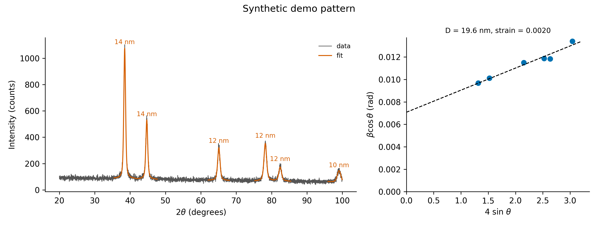

# Day 17: XRD Scherrer crystallite size

**What:** Fits the peaks of a powder X-ray diffraction pattern, subtracts the instrumental broadening, and calculates the crystallite size from the Scherrer equation, with an uncertainty for each peak. With three or more peaks it can also fit a Williamson-Hall plot to separate size broadening from strain broadening.
**Why:** Crystallite size is a standard number in nanomaterial papers, and it is easy to get wrong: using the observed width without removing the instrument's, mixing degrees and radians, or applying the equation to a peak that is dominated by strain. This does the fit and the arithmetic the same way every time and tells you when the result is not trustworthy.

## Install
```bash
pip install numpy scipy matplotlib
```

## Usage
A pattern file has 2-theta (degrees) in column 1 and the intensity in column 2. `--inst-fwhm` is the instrumental width in degrees 2-theta, measured on a standard such as LaB6 or silicon (use 0 if you do not have it):
```bash
python tool.py example/synthetic_xrd.csv --inst-fwhm 0.08 --williamson-hall -o xrd.png --title "Synthetic demo pattern"
```
```
wavelength 1.54056 A, K = 0.9, instrumental FWHM 0.08 deg (gaussian), fit weights: poisson
 2theta    d (A)   FWHM obs  FWHM corr  size (nm)  +/- (nm)
  38.47   2.3382     0.5929     0.5874       14.3       0.1
  44.71   2.0251     0.6320     0.6269       13.7       0.2
  65.09   1.4319     0.7859     0.7818       12.1       0.3
  78.22   1.2211     0.8807     0.8770       11.7       0.2
  82.43   1.1690     0.9056     0.9021       11.7       0.5
  99.07   1.0125     1.1863     1.1836       10.3       0.8
Scherrer size over 6 peaks: mean 12.3 nm, SD 1.5 nm
Williamson-Hall (6 peaks): size 19.6 +/- 1.3 nm, strain 0.00197 +/- 0.00020, R2 0.960
```


**The example data are synthetic.** `make_example.py` generates them (fixed random seed): a face-centered cubic pattern whose peak widths follow the Williamson-Hall relation with a true size of 20 nm and a strain of 0.002, plus an instrumental width of 0.08 degrees, a sloping background and counting noise. They are not measured data.

This example shows why one peak is not enough. The Scherrer size falls from 14.3 nm to 10.3 nm as the angle rises, because strain broadening grows with the angle and the plain Scherrer equation attributes all of the broadening to size. The Williamson-Hall fit separates the two and returns 19.6 +/- 1.3 nm and a strain of 0.0020, consistent with the 20 nm and 0.002 used to make the data.

Peaks you measured yourself (no file needed):
```bash
python tool.py --peak 38.5 0.45 --peak 44.7 0.47 --inst-fwhm 0.08
```
```
  38.50   2.3364     0.4500     0.4428       19.0
  44.70   2.0256     0.4700     0.4631       18.5
Scherrer size over 2 peaks: mean 18.8 nm, SD 0.3 nm
```
More examples:
```bash
python tool.py pattern.csv --source cu-ka --k 0.94 --range 30 80 --csv sizes.csv
python tool.py pattern.csv --peak-positions 26.2 --window 12 --smooth 0     # one very broad peak
python tool.py pattern.csv --inst-fwhm 0.06 --correction lorentzian --prominence 0.1
```

| Option | Meaning |
|---|---|
| `--source`, `--wavelength` | X-ray line (`cu-ka1` default, `cu-ka`, `co-ka1`, `co-ka`, `cr-ka1`, `cr-ka`, `mo-ka1`, `mo-ka`), or a wavelength in angstrom |
| `--k` | shape factor (default 0.9) |
| `--inst-fwhm`, `--correction` | instrumental width in degrees, removed as `gaussian` (default, in quadrature), `lorentzian` (subtracted) or `none` |
| `--range LOW HIGH` | use only this 2-theta range |
| `--peak-positions` | fit these positions instead of detecting peaks |
| `--prominence`, `--smooth`, `--min-separation` | peak detection: threshold as a fraction of the intensity range (default 0.05), smoothing used only for detection (default about 0.25 degrees, 0 turns it off) and minimum distance between peaks (degrees) |
| `--weights` | point weights in the fits: `auto` (default: `poisson` if the intensities are whole numbers), `poisson` (counting statistics, for raw counts) or `none` |
| `--window` | half-width of the fit window in degrees (default 3). Widen it for very broad peaks |
| `--williamson-hall` | also fit a Williamson-Hall plot |
| `--peak 2THETA FWHM` | give a peak directly instead of a file (repeat for several) |
| `-o`, `--csv`, `--title`, `--figsize`, `--dpi` | plot and per-peak CSV |

## Method
1. **Detect peaks.** The pattern is smoothed (for detection only) and peaks are found with `scipy.signal.find_peaks`. Smoothing matters: on raw counting noise a random spike can look prominent next to the deepest noise dips, and without it the example pattern gives false peaks.
2. **Fit each peak** on the raw data with a pseudo-Voigt function (one FWHM for the Gaussian and Lorentzian parts, a free mixing fraction) on a linear background, in a window that stops halfway to the neighbouring peak. The fit gives the position, the FWHM and its uncertainty. For raw counts the points are weighted by their counting uncertainty, sqrt(counts), and the uncertainties are taken from those absolute weights; the reduced chi-square is reported as a check (about 1 means the peak shape describes the data within counting noise). For intensities that are not counts the fit uses equal weights.
3. **Remove the instrument.** Gaussian: beta = sqrt(FWHM_obs^2 - FWHM_inst^2). Lorentzian: beta = FWHM_obs - FWHM_inst. If the peak is not wider than the instrument, no size is reported.
4. **Scherrer equation:** D = K x lambda / (beta x cos(theta)), with beta in radians and theta half of the 2-theta position. The uncertainty comes from the FWHM uncertainty of the fit.
5. **Williamson-Hall** (optional): the points beta x cos(theta) against 4 sin(theta) are fitted with a line. The intercept is K x lambda / D and the slope is the strain.
6. d-spacings come from Bragg's law.

Wavelengths are the values listed by the UNSW XRD Lab (Tian, "Choice of X-ray sources") and the UNT lecture notes on XRD (Golden): the K-alpha1 line, and the K-alpha average of the alpha1/alpha2 doublet, for Cu, Co, Cr and Mo. Use `--wavelength` for any other source.

## Test
```bash
pytest days/day17-xrd-scherrer
```
The tests check the equation by hand, its scaling, the instrument corrections, the size uncertainty against a simulation, the fit uncertainty and reduced chi-square against 120 simulated fits, exact recovery of size and strain from the Williamson-Hall fit, the peak shape, fitting and detection on a synthetic pattern with counting noise, the file reader, the warnings and every error message.

## Limitations
- **Scherrer gives the size of coherently diffracting domains, not the particle size.** It applies to crystallites below about 100 nm. Above that the broadening is close to the instrument's and the result is not reliable (the tool warns).
- **The instrumental width must come from a standard** measured on your instrument and setting. A wrong value changes the size a lot, especially for peaks that are only a little wider than the instrument (the tool warns below 1.5 times).
- K depends on the crystallite shape and on how the width is defined. 0.9 is the usual default, and values from about 0.8 to 1.0 are used. Quote the K you used.
- The plain Scherrer size is a lower bound when strain is present. Williamson-Hall assumes the strain is the same in all directions and that size and strain broadening add linearly. It fails for anisotropic broadening.
- The Cu K-alpha1/alpha2 doublet is not separated. At high angles the unresolved doublet widens the peaks, so use K-alpha1 data if you have it.
- Overlapping peaks are fitted one at a time, so they should be separated by more than their widths. A joint fit of overlapping peaks is not implemented.
- Very broad peaks (a few degrees wide, as for the graphitic band of many carbon dots) need `--window` and `--smooth 0`, and the result then reflects a few nanometres of coherent ordering and not the size of a particle. Compare it with TEM.
- **The uncertainties are only as good as the weights.** In a simulation of 300 noisy peaks, the Poisson-weighted fit reported an FWHM uncertainty that matched the real scatter (97% of it, reduced chi-square 1.01), while an equal-weight fit of the same counts reported only 57% of it, because the noise grows with the signal. If your intensities are counts per second or normalized, convert them back to raw counts (multiply by the counting time) before fitting, or treat the uncertainties as optimistic.
- The uncertainties cover counting noise and the fit only. They do not include the instrumental width, K, the choice of peak shape or the background model, which usually matter more.
- The warning for a poor fit (R2 below 0.8 near the peak, or a reduced chi-square above 3) only catches clear failures. Check the plot.

## Next
Day 18: TEM particle size distribution from measurements (histogram plus lognormal fit).
