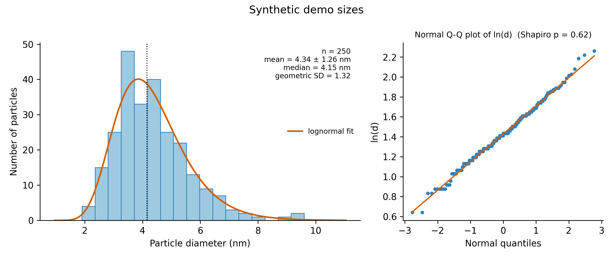

# Day 18: TEM particle size distribution

**What:** Turns a list of particle sizes measured on TEM images into a histogram with a fitted lognormal curve, and reports the numbers a paper needs: mean and SD, median, geometric mean and geometric SD, each with a confidence interval, plus checks of how well a lognormal (and a normal) distribution describes the data.
**Why:** Nanoparticle and carbon dot sizes are almost always reported as "mean +/- SD" from a hand-measured histogram, and the distribution is usually skewed, so the plain mean and SD can mislead. This does the arithmetic the same way every time, shows whether a lognormal fits, and tells you how uncertain the result is for the number of particles you measured.

## Install
```bash
pip install numpy scipy matplotlib
```

## Usage
The input is a text file with one measured value per row, for example a column of an ImageJ "Results" export. If the file has several columns, pick one with `--column` (by name or by number from 1).
```bash
python tool.py example/synthetic_sizes.csv --column diameter_nm -o sizes.png --title "Synthetic demo sizes"
```
```
n = 250 particles (column 'diameter_nm', nm)
number-weighted statistics
  mean +/- SD        4.34 +/- 1.26 nm   (CV 29 %, PDI = (SD/mean)^2 = 0.085)
  mean, 95% CI       4.18 to 4.5 nm
  median             4.15 nm   (range 1.9 to 9.6)
lognormal fit (mean and SD of ln d)
  geometric mean     4.17 nm   (95% CI 4.03 to 4.32)
  geometric SD       1.32   (ln sigma = 0.281 +/- 0.013)
  mean / mode        4.34 / 3.86 nm
checks
  Shapiro-Wilk p     3.56e-08 for d (normal), 0.622 for ln d (lognormal)
  AIC normal - lognormal = 37.8   (positive favours the lognormal)
```


**The example data are synthetic.** `make_example.py` draws them (fixed random seed) from a lognormal distribution with a median of 4.2 nm and a geometric SD of 1.32, rounded to 0.1 nm like a manual measurement. They are not measured data. The tool recovers a geometric mean of 4.17 nm (95% interval 4.03 to 4.32, which contains the true 4.2) and a geometric SD of 1.32.

Areas from ImageJ or similar software: `--from-area` converts each area to the diameter of a circle with the same area, and `--unit-scale` converts pixels to nanometres (here 0.25 nm per pixel):
```bash
python tool.py example/synthetic_imagej.csv --column Area --from-area --unit-scale 0.25 -o imagej.png --no-qq
```
```
n = 220 particles (column 'Area' as equivalent circle diameter, scaled by 0.25, nm)
...
  geometric mean     6.03 nm   (95% CI 5.87 to 6.19)
  geometric SD       1.22   (ln sigma = 0.197 +/- 0.009)
```
(The synthetic truth for this file is a median of 6.0 nm and a geometric SD of 1.20.)

More options:
```bash
python tool.py sizes.csv --bin-width 0.5 --density --also-normal --hist-csv bins.csv
python tool.py sizes.csv --bins fd --csv summary.csv --unit-label nm
```

| Option | Meaning |
|---|---|
| `--column` | column to use (name or number from 1). Needed if the file has more than one |
| `--from-area`, `--unit-scale` | the column holds areas, so use the equivalent circle diameter, and multiply lengths by this (for example nm per pixel) |
| `--bins`, `--bin-width` | number of bins or a rule (`auto`, `fd`, `sturges`, `scott`, `doane`, `rice`, `sqrt`), or a fixed bin width |
| `--density`, `--also-normal`, `--no-qq` | plot probability density instead of counts, add the normal fit, leave out the Q-Q plot |
| `-o`, `--csv`, `--hist-csv` | save the plot (`.png`, `.svg`, `.pdf`), the one-row summary and the histogram bins |
| `--unit-label`, `--title`, `--figsize`, `--dpi` | appearance |

## Method
- **Number-weighted statistics:** mean, sample SD, standard error, a 95% confidence interval for the mean from Student's t, the median, the coefficient of variation, and PDI = (SD/mean)^2 (the definition used in DLS reports; TEM papers vary).
- **Lognormal fit:** the mean and sample SD of ln(d) give mu and sigma. The geometric mean is exp(mu) with a 95% interval from the t distribution on mu, and the geometric SD is exp(sigma). The standard errors are sigma/sqrt(n) for mu and sigma/sqrt(2(n-1)) for sigma. The lognormal mean and mode are exp(mu + sigma^2/2) and exp(mu - sigma^2).
- **Checks:** the Shapiro-Wilk test on d (normal) and on ln(d) (lognormal), for up to 5000 particles, and the AIC difference between a normal and a lognormal model (positive favours the lognormal). The Q-Q plot of ln(d) shows where the fit departs from a straight line.
- **Histogram:** bin edges from a numpy rule, a number of bins or a fixed width. The fitted curve is scaled to the counts (or drawn as a density).
- **Validation:** the tests simulate 600 samples of 100 particles and check that the 95% intervals for the geometric mean, the mean and ln(sigma) contain the truth about 95% of the time. A larger check of 2000 samples gave 95.0%, 95.5% and 95.2%.

## Which numbers to report
For a skewed distribution the arithmetic mean sits above the median. If the lognormal fits (Shapiro p for ln(d) is not small, and the AIC difference is positive), the geometric mean and geometric SD describe the data better than mean +/- SD. In the example the plain mean is 4.34 nm and the geometric mean 4.17 nm. If you report mean +/- SD, say that the distribution is skewed and give n.

## Test
```bash
pytest days/day18-tem-size-distribution
```
The tests check the formulas on a sample with exactly known logarithms, recovery of known parameters, the coverage of the intervals, the AIC and Shapiro checks, the bin options, the warnings, every reader variant (ImageJ-style blank header, decimal commas), the plots and every error message.

## Limitations
- **The intervals assume independent measurements.** Particles from the same image or grid are not independent. Measure across several images and grids, because the true uncertainty is larger than the one printed when the particles come from one field.
- **Number of particles.** The tool warns below 100 particles and again below 30, because the width of the distribution is poorly determined from few particles. Measure many more for a distribution you plan to publish.
- This is a number-weighted distribution of 2D projections. It is not a volume-weighted or intensity-weighted one, and it is not corrected for overlap, cut-off at the image edge or contrast thresholds. Non-spherical particles need a choice such as Feret diameter or equivalent circle diameter, and the two give different numbers.
- The calibration of the image scale, and the error of the manual measurement, are not in the uncertainty. If your measurements are quantized (for example to the pixel size), keep the bins wider than that. The tool warns when `--unit-scale` is given and the bins are narrower than it.
- A single lognormal may not fit. Two populations, aggregates or truncation show up as a small Shapiro p-value, a curved Q-Q plot or a long tail (flagged when the largest particle is over 5 times the median). Then do not summarize with one curve.
- The Shapiro-Wilk test is not computed for more than 5000 particles (the p-values are left blank).
- Hypothesis tests on the fit are for guidance. With many particles even a tiny departure from lognormal gives a small p-value.

## Next
Day 19: baseline correction and smoothing toolkit for spectra.
