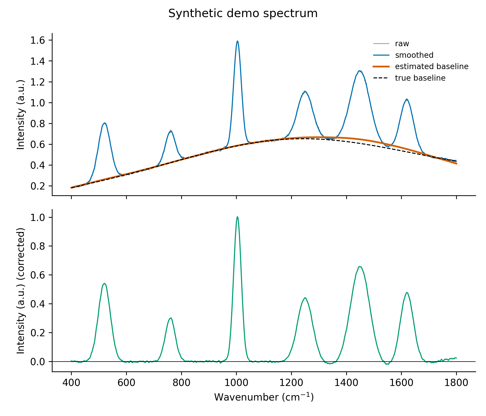

# Day 19: Baseline correction and smoothing toolkit

**What:** Smooths a spectrum and removes its baseline with the usual methods (Savitzky-Golay, moving average, Gaussian, median and Whittaker smoothing; modified polynomial, asymmetric least squares, SNIP and anchor-point baselines), and reports what the processing did: how much noise went away, how much the peaks were flattened, whether the baseline ate the peaks, and, for simulated data, how well a known baseline was recovered.
**Why:** UV-vis, fluorescence, FTIR, Raman and XRD spectra all arrive on a baseline, and every day of this spectroscopy phase assumed it was already removed. Baseline correction is easy to do badly without noticing: a baseline that is too flexible quietly deletes the peaks. This makes the choices explicit and checks them.

## Install
```bash
pip install numpy scipy matplotlib
```

## Usage
```bash
python tool.py example/synthetic_spectrum.csv --smooth savgol --window 11 \
    --baseline asls --baseline-lambda 1e7 --truth example/synthetic_baseline_truth.csv -o corrected.png
```
```
1401 points, x 400 to 1800 (step 1), noise level 0.007244
smoothing: savgol -> noise level 0.002909, highest peak kept at 99.5%
baseline: asymmetric least squares, lambda 1e+07, p 0.01, 6 iterations (range 0.1816 to 0.667)
corrected: range -0.02069 to 1.003
peaks: 102% of the peak prominence kept (median over 6 clear peaks)
against the true baseline: RMS error 0.0174 (2.4 noise levels), largest error 0.04022
```


**The example data are synthetic.** `make_example.py` generates them (fixed random seed): six Gaussian peaks on a smooth, curved background that looks like a fluorescence baseline, plus noise (sigma 0.006). Because the true baseline is known (`synthetic_baseline_truth.csv`), `--truth` can measure how well each method recovers it. Real spectra have no known baseline, so this comparison only exists for simulated data. They are not measured data.

The baseline is estimated on the smoothed spectrum, and the output is the smoothed spectrum minus the baseline. Save the result for the other tools in this repo with `--corrected-only`, which writes just `x` and `corrected`:
```bash
python tool.py spectrum.csv --baseline asls --baseline-lambda 1e7 --csv corrected.csv --corrected-only
python ../day16-ftir-peak-picker/tool.py corrected.csv --signal absorbance
```
More examples:
```bash
python tool.py spectrum.csv --smooth gaussian --sigma 3 --baseline snip --width 100
python tool.py spectrum.csv --baseline poly --degree 5 --xmin 450 --xmax 1700
python tool.py spectrum.csv --baseline anchors --anchors 420 650 880 1130 1360 1540 1790 --anchor-width 20 --anchor-kind cubic
python tool.py ftir.csv --smooth median --window 5 --baseline asls --reverse-x --xlabel "Wavenumber (cm$^{-1}$)"
```

| Option | Meaning |
|---|---|
| `--smooth` | `none` (default), `savgol`, `moving-average`, `gaussian`, `median` or `whittaker` |
| `--window`, `--order` | window in points for savgol, moving-average and median (odd for savgol and median), and the savgol polynomial order (default 3) |
| `--sigma`, `--smooth-lambda` | gaussian width in x units, and the whittaker smoothness (default 100) |
| `--baseline` | `none` (default), `poly`, `asls`, `snip` or `anchors` |
| `--degree` | polynomial degree for `poly` (default 4) |
| `--baseline-lambda`, `--asymmetry` | stiffness (default 1e5) and p (default 0.01) for `asls` |
| `--width`, `--no-lls` | for `snip`: the width of the widest peak in x units, and whether to skip the log-log-square transform |
| `--anchors`, `--anchor-width`, `--anchor-kind` | for `anchors`: peak-free x positions, the range averaged around each, and `linear` or `cubic` |
| `--baseline-from` | estimate the baseline on the `smoothed` (default) or the `raw` spectrum |
| `--truth FILE` | a file with the true baseline (x, baseline), to measure the error against |
| `--xmin`, `--xmax` | range to use |
| `-o`, `--csv`, `--corrected-only` | plot (`.png`, `.svg`, `.pdf`), and the processed data (all columns, or just `x` and `corrected`) |
| `--reverse-x`, `--xlabel`, `--ylabel`, `--title`, `--figsize`, `--dpi` | plot appearance |

## Methods
| Method | What it does | Reference |
|---|---|---|
| Savitzky-Golay | fits a polynomial in a sliding window. Keeps peak heights better than a plain average | Savitzky and Golay, *Anal. Chem.* 1964, 36, 1627 (cited from memory, not checked here) |
| Whittaker | penalized least squares: closeness to the data against roughness of the curve | Eilers, *Anal. Chem.* 2003, 75, 3631 (cited from memory, not checked here) |
| moving average, Gaussian, median | box, Gaussian and median filters. The median removes single-point spikes | |
| `poly` | modified polynomial fit: fit a polynomial, keep the lower of the data and the fit at each point, repeat until it stops changing | Lieber and Mahadevan-Jansen, *Appl. Spectrosc.* 2003, 57, 1363 |
| `asls` | asymmetric least squares: a smooth curve where points above it get weight p and points below get 1 - p, so it settles under the peaks | Eilers and Boelens, Leiden University Medical Centre report, 2005 |
| `snip` | sensitive nonlinear iterative peak clipping with a growing window, on log-log-square transformed data | Ryan et al., *Nucl. Instrum. Methods B* 1988, 34, 396; Morhac et al., *Nucl. Instrum. Methods A* 1997, 401, 113 |
| `anchors` | the median of the data near positions you pick, joined by a line or a cubic spline | |

The references marked as not checked are the two I cited from memory. The other four I looked up while writing this. For `asls`, the ranges usually suggested are p between 0.001 and 0.1 and lambda between 10^2 and 10^9, which is how the method's parameters are described in software documentation that credits the original paper. For `snip`, the half-window is about (width of the widest peak in points - 1) / 2.

## Which method? A benchmark on the example
Each baseline method against the known baseline of the example spectrum (noise level 0.0072):

| Method and settings | RMS error | in noise levels | peak prominence kept |
|---|---|---|---|
| `poly`, degree 4 | 0.0255 | 3.5 | 100% |
| `poly`, degree 5 | 0.0200 | 2.8 | 102% |
| `asls`, lambda 1e7, p 0.01 | 0.0171 | 2.4 | 102% |
| `asls`, lambda 1e5, p 0.01 | 0.0588 | 8.1 | 90% |
| `snip`, width 100 | 0.0206 | 2.8 | 103% |
| `anchors`, 7 anchors in peak-free regions, cubic | 0.0141 | 2.0 | 104% |

Three lessons. The settings matter more than the method: the same `asls` is three times worse with lambda 1e5 than with 1e7, because the more flexible baseline starts to follow the broad peaks. Anchors are the most accurate here, but only because I knew where the peak-free regions were. And none of them recovers the baseline to within the noise.

## What the tool checks
- **Noise level** before and after smoothing, from the point-to-point differences (robust to the baseline and to broad peaks, but a little high when peaks are steep: it reads 0.0072 for the example, which has 0.006).
- **Highest peak kept:** how much of the tallest peak survives smoothing. It warns below 95% (the window is too wide).
- **Peak prominence kept:** for every clear peak (at least 10 noise levels high) it compares the prominence before and after baseline removal. About 100% means the baseline stayed under the peaks. It warns below 70%, which means the baseline followed the peaks. For example `--baseline asls --baseline-lambda 1e3 --asymmetry 0.5` keeps only 7% of the prominence, and `--baseline snip --width 15` keeps 13%.
- **Points far below zero:** it warns when more than 5% of the corrected points are more than 3 noise levels below zero.
- Uneven x spacing, and a polynomial degree above 8.
- With `--truth`: the RMS and largest error against the known baseline.

## Test
```bash
pytest days/day19-baseline-smoothing
```
The tests check each smoother (a polynomial is kept, spikes are removed, noise is reduced, the area is kept), each baseline method against the known baseline, the benchmark above (every method must recover the example baseline), the checks that tell a good baseline from a bad one, the plots, both CSV layouts and every error message.

## Limitations
- **No method is right in general.** Every result depends on settings that you choose, and the benchmark shows a threefold difference from one parameter. Always look at the plot.
- **The prominence check only catches gross failures.** `asls` with lambda 1e5 above is 8 noise levels from the truth and still keeps 90% of the prominence, so it raises no warning. The comparison with a known baseline exists only for simulated data.
- **Smoothing changes the data.** It broadens and lowers peaks, most for the moving average and least for Savitzky-Golay. For peak heights, areas or widths, prefer raw data with a fit, or use the same settings for every spectrum you compare, and report them.
- **SNIP bends a sloping baseline.** On a peak-free straight line it never rises above the data, but it can sit below it by up to about 4% of the total rise (measured with half-window 50), most at the ends.
- Asymmetric least squares and Whittaker smoothing assume evenly spaced x. The tool warns when the spacing is not even.
- Widths and positions (`--width`, `--sigma`, `--anchors`, `--anchor-width`) are in the x units of your file, and the windows in points are not.
- The baseline is estimated from the smoothed spectrum by default. For very noisy data this is better, but it passes the smoothing on to the result. Use `--baseline-from raw` to avoid that.
- There is no spike (cosmic ray) detection except the median filter, and no handling of 2D data.

## Next
Day 20 closes Phase 2 with the first mini release, `spectra-kit`, combining Days 11 to 19 as a package.
